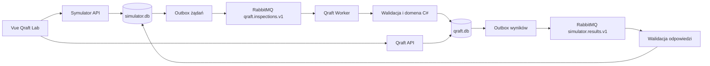

# Przepływ danych

## Kontrakty

W `Qraft.Contracts` są struktury `InspectionSubmittedV1` i `InspectionProcessedV1`. Żądanie ma identyfikator wiadomości, symulacji i partii, metadane etapu oraz trzy próbki z trzema pomiarami. Wersja schematu wynosi 1. Pole `stage` przyjmuje E1 lub E2.

Nagłówek żądania AMQP `MessageId` odpowiada polu `messageId`, a `CorrelationId` identyfikatorowi symulacji. Odpowiedź ma `MessageId = resultId`, `CorrelationId = messageId` źródła. Symulator sprawdza również `simulationId` w swojej bazie.

Poprawne dane są oceniane jako `Processed / Conformant` albo `Processed / Nonconformant`. Błędny JSON, nieobsługiwany schemat albo brak wymaganych wartości dają `Rejected`, listę błędów i brak oceny jakości.

## Trwałość i ponowienia

- Symulator zapisuje przebieg, dane źródłowe i outbox w jednej transakcji.
- Qraft zapisuje surowe wejście, hash SHA-256, wynik, próbki i outbox odpowiedzi w jednej transakcji. ACK następuje po commit.
- Kolejki są trwałe, wiadomości persistent, publikacje używają publisher confirms. Outbox oznacza wysłanie dopiero po potwierdzeniu brokera.
- Dostarczenie ma semantykę co najmniej raz. Ten sam MessageId i ten sam hash zwracają poprzedni wynik; nie tworzą kolejnego badania. Symulator zachowuje pierwszy wynik i ignoruje jego retransmisje.
- Ten sam MessageId z inną treścią trafia na DLQ. Nie nadpisuje historii.
- Brak poprawnego identyfikatora AMQP, nieprawidłowe UTF-8, przekroczenie 128 KiB oraz niepasujące odpowiedzi trafiają do `qraft.dead-letters.v1`. Pozostałe błędy kontraktu mają zapisaną odpowiedź Rejected.
- Błąd DB pozostawia wiadomość niepotwierdzoną lub ponownie zakolejkowaną. Błąd publikacji pozostawia zadanie w outboxie z opóźnieniem kolejnej próby.

Kolejka odpowiedzi jest wspólna dla jednego lokalnego symulatora. Wiele niezależnych symulatorów wymaga osobnego routingu odpowiedzi; obecna implementacja tego nie udaje.

## Bazy

`data/qraft.db`: `ReceivedInspections`, `SampleAssessments`, `ResultOutbox` i historia migracji. Wynik zawiera pełne wartości pomiarów, limity i przyczyny odrzucenia. `data/simulator.db`: scenariusze źródłowe, przebiegi, komunikaty, ich outbox oraz odpowiedzi Qraft. Każda aplikacja zarządza wyłącznie swoją bazą.

Schemat startowy przechowuje przyjęte komunikaty i wyniki. Pełny model produkcyjny Partia/Badanie/Decyzja/Działanie z dokumentacji akademickiej będzie kolejnym krokiem, a nie samą zmianą etykiet rekordów importu.

Źródła implementacji transportu: [RabbitMQ .NET API](https://www.rabbitmq.com/client-libraries/dotnet-api-guide), [potwierdzenia odbioru i publikacji](https://www.rabbitmq.com/docs/confirms). Obsługa SQLite: [EF Core SQLite](https://learn.microsoft.com/en-us/ef/core/providers/sqlite/).

## Granica potwierdzenia

Oryginalne modele i migracje obu baz są częścią źródeł. Pełny model produkcyjny i egzekwowanie ręcznych decyzji nadal nie są zaimplementowane. Wyniki aktualnych testów i ograniczenia środowiska: [WERYFIKACJA.md](../WERYFIKACJA.md).
